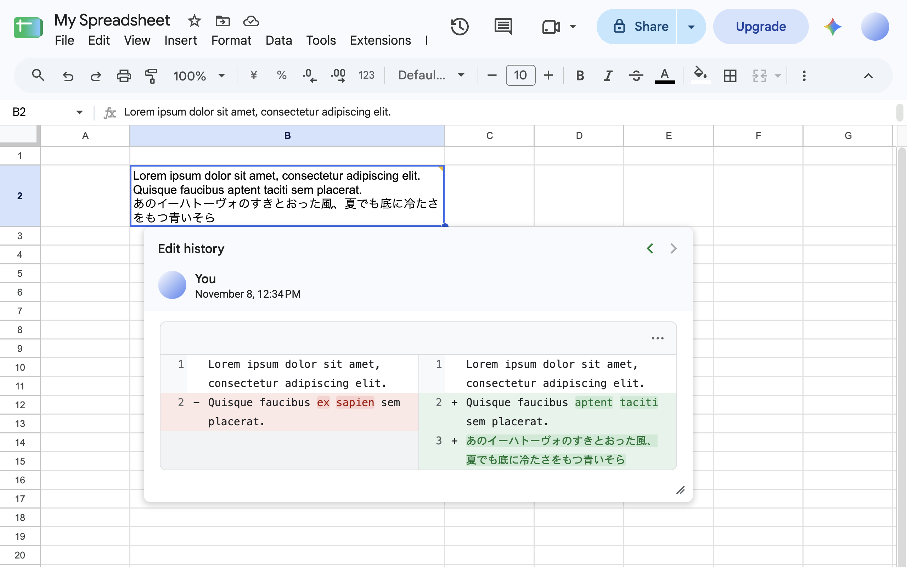
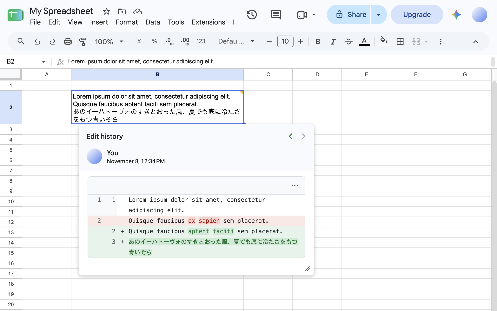
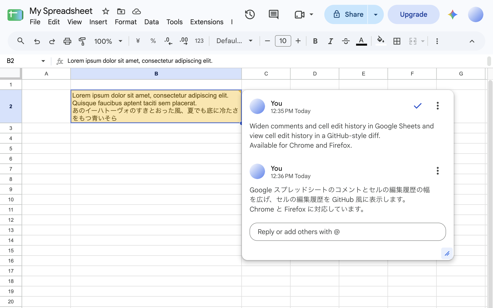
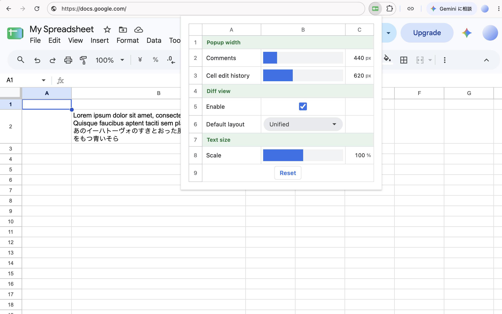

# Sheets Popup Enhancer

English | [日本語](README.md)

Sheets Popup Enhancer is a browser extension that widens comments and cell edit history in Google Sheets and displays cell edit history as a GitHub-style diff. It supports Chrome 120 and later and Firefox 140 and later.









The project uses WXT, Svelte 5, TypeScript, and a pnpm workspace for the extension and shared packages.

## Load in Chrome

Use Node.js 22.12 or later and pnpm 12.

```sh
cd sheets-popup-enhancer
pnpm install
pnpm build
```

1. Open `chrome://extensions` in Chrome and enable Developer mode.
2. Select **Load unpacked** and choose `apps/extension/.output/chrome-mv3`.
3. Reload the Google Sheets tab.
4. Open a comment or use the cell's context menu to open its edit history.

## Load in Firefox

After installing Node.js and pnpm, run `pnpm install`, followed by:

```sh
pnpm build:firefox
```

1. Open `about:debugging#/runtime/this-firefox` in Firefox.
2. Select **Load Temporary Add-on** and choose `apps/extension/.output/firefox-mv3/manifest.json`.
3. Reload the Google Sheets tab and open a comment or cell edit history.

The temporary add-on is removed when Firefox exits.

Use the extension icon to set the default widths and text size for comments and edit history, enable or disable the diff, and choose the initial layout. Changes are saved automatically; **Reset** restores the defaults. A manually resized width lasts for the current popup, and the configured default is used the next time it opens.

The settings panel and diff labels follow the browser language and support Japanese, English, Simplified Chinese, Traditional Chinese, Korean, Spanish, French, Indonesian, Brazilian Portuguese, Russian, German, and Arabic. Other languages fall back to English. This setting is independent of the language used to parse Sheets history.

For development, run `pnpm dev` for Chrome or `pnpm dev:firefox` for Firefox. Follow WXT's instructions for loading and reloading the extension.

## Features

- Drag to resize comments and cell edit history horizontally.
- Keep popups within the viewport. Long content can scroll, while the resize handle stays at the bottom right.
- Show line numbers and highlight word-level changes in diffs.
- Switch between Unified and Split layouts. Unified shows deletions and additions in one table; Split aligns corresponding before and after lines. Additions to empty cells and complete deletions use Unified.
- Copy the before or after value from the diff menu. Histories whose values cannot be determined use the native Sheets view.
- Show full text without line numbers or diff colors when either value exceeds 10,000 characters.
- Preserve quotes and whitespace in formula history diffs.
- Parse known history structures in supported languages. Partial changes in the latest history entry are checked against the current value in the formula bar.
- Keep the native Google Sheets view for unsupported history.
- Save settings locally and apply changes to open Sheets tabs.

## Project structure

```text
apps/
  extension/             WXT browser extension
    entrypoints/         Content script and settings popup
    src/sheets/          Sheets-specific history parsing
    src/ui/              Svelte components inserted into Sheets
packages/
  diff-ui/               Sheets-independent Svelte diff view
  resizable/             Framework-independent resize behavior
tests/browser/           Browser tests for the built extension
```

`diff-ui` and `resizable` are referenced through `workspace:*`. They do not need to be published to npm or built separately.

`src/sheets/` separates DOM reading, change matching, and language-specific parsing, which are called from `history.ts`. `popup-controller.ts` manages the popup lifecycle, and `popup-layout.ts` handles positioning. For recognized history, a diff UI is inserted in a Shadow DOM next to the original history, which is temporarily hidden. The original nodes are kept and restored when switching to unsupported history, disabling the diff, or reinitializing the extension.

## Validation

```sh
pnpm format          # Format code with Oxfmt
pnpm lint            # Check code with Oxlint
pnpm check           # Lint, format checks, and TypeScript / Svelte type checks
pnpm test            # Unit tests for history parsing, diffs, and resizing
pnpm test:e2e        # Build the extension and run Chrome browser tests
pnpm test:e2e:firefox # Build the Firefox extension and run Firefox browser tests
pnpm zip             # Package the extension as a ZIP
pnpm zip:firefox     # Create Firefox extension and source ZIPs
```

Oxlint limits each function's cyclomatic complexity to 12, prohibits nested ternaries, and uses type information to detect floating promises. Type-aware rules apply to TypeScript files, not Svelte files. A promise marked with `void` is not reported, so handle failures where needed. Oxlint does not check Svelte templates, which should be reviewed separately. Oxfmt uses two-space indentation, single quotes, and a target line width of 100 characters.

Chrome browser tests use the installed Google Chrome. Firefox tests require `pnpm exec playwright install firefox` beforehand. They check layout switching, resizing, safe text rendering, small windows, and settings persistence. Test pages use the same classes and structures as Sheets and load the built content script. They do not run against actual Google Sheets.

GitHub Actions runs `pnpm check`, `pnpm test`, and `pnpm test:e2e` on every push. After a successful push to main, it creates a `vA.B.C` tag and GitHub Release from the extension manifest version and attaches Chrome and Firefox ZIPs. If the tag already points to another commit, the existing release is left unchanged and creation is skipped. Update the version in `apps/extension/wxt.config.ts` for a new release.

## Limitations

- Changes to the Google Sheets DOM, staged rollouts, or display languages may prevent the extension from detecting a popup.
- Language support covers known structures only. The latest formula replacement can also be recognized in other languages when comparing it with the current formula identifies both values. Not every language or history pattern is supported.
- Partial diffs are parsed only for known formats in supported languages. The latest history entry is checked against the formula bar; mismatches and unsupported structures retain the native history view. This assumes the history and formula bar refer to the same cell. For a standalone English addition where whitespace counts differ, the displayed history value is used as the before value after a consistency check.
- Resizing changes width only. History content scrolls within the available viewport height.
- Fine-grained highlighting is omitted if the computation time limit is reached.

## Data handling

See also the [privacy policy](PRIVACY.md).

Cell values are compared in the browser. Cell values and comments are neither sent externally nor stored in extension settings. When you select a copy action, the selected value is written to the clipboard. Only widths, text size, layout, and the enabled state of the diff are saved in `chrome.storage.local`; settings are not synced across devices.

The production extension loads its bundled CSS from its own extension URL. It does not load libraries, fonts, or scripts from a CDN.

## Troubleshooting

| Symptom | What to check |
| --- | --- |
| Width does not change | Confirm that the extension was loaded from the build output for the correct browser, then reload Sheets. |
| Diff does not appear | Check that the diff is enabled in settings. Unsupported history retains the native view. |

## Development terms

| Term | Meaning in this project |
| --- | --- |
| content script | Extension code running inside a Google Sheets page |
| Shadow DOM | A way to isolate the extension UI from Sheets styles |
| workspace | A way to manage the app and packages in the same repository |

## License

This project is released under the [MIT License](LICENSE). Licenses for dependencies and other third parties are collected in [THIRD_PARTY_LICENSES.txt](apps/extension/public/THIRD_PARTY_LICENSES.txt), which is also included in the extension.

Sheets DOM selectors and history structures were informed by [better-gsheets-popups-extension](https://github.com/wintorse/better-gsheets-popups-extension).
