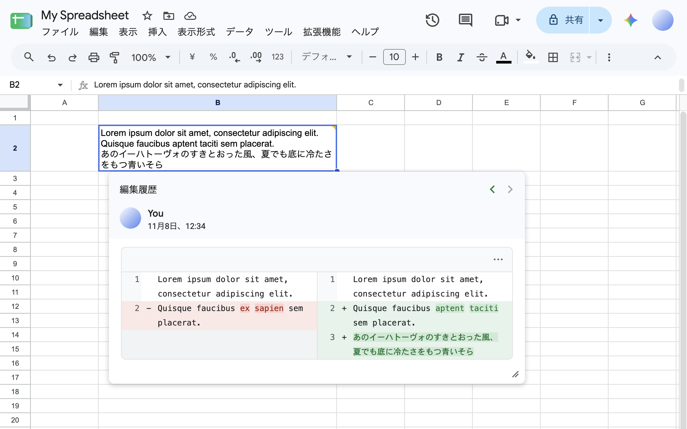
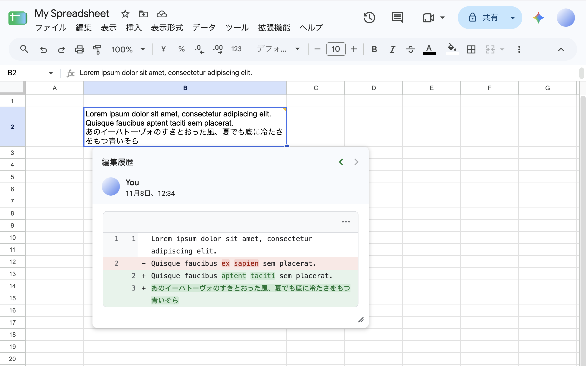
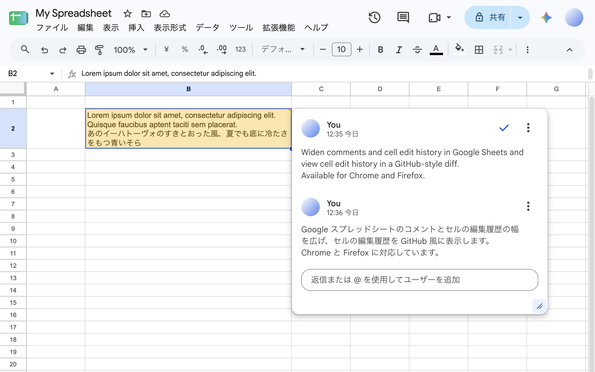
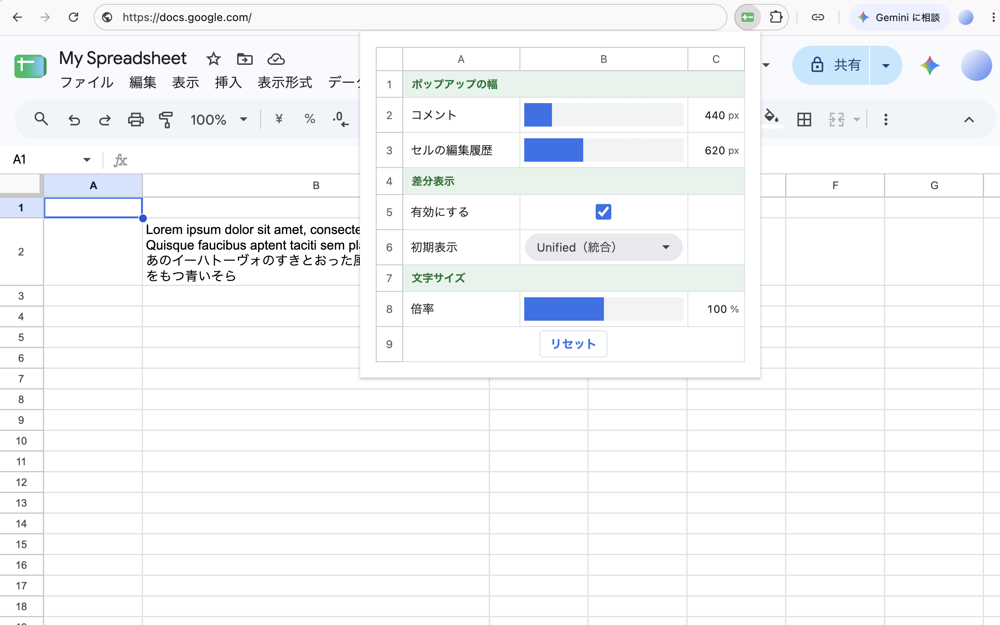

# Sheets Popup Enhancer

[English](README.en.md) | 日本語

Google スプレッドシートのコメントとセルの編集履歴の幅を広げ、セルの編集履歴をGitHub風に表示するブラウザ拡張機能です。Chrome 120以降とFirefox 140以降に対応しています。









WXT・Svelte 5・TypeScriptを使い、pnpm workspaceで拡張機能と共通パッケージを管理しています。

## Chromeに読み込む

Node.js 22.12以降とpnpm 12を使用します。

```sh
cd sheets-popup-enhancer
pnpm install
pnpm build
```

1. Chromeで `chrome://extensions` を開き、デベロッパーモードを有効にします。
2. 「パッケージ化されていない拡張機能を読み込む」から `apps/extension/.output/chrome-mv3` を選びます。
3. Google スプレッドシートのタブを再読み込みします。
4. コメント、またはセルの右クリックメニューから編集履歴を開きます。

## Firefoxに読み込む

Node.jsとpnpmを用意し、`pnpm install` の後に以下を実行します。

```sh
pnpm build:firefox
```

1. Firefoxで `about:debugging#/runtime/this-firefox` を開きます。
2. 「一時的なアドオンを読み込む」から `apps/extension/.output/firefox-mv3/manifest.json` を選びます。
3. Google スプレッドシートのタブを再読み込みし、コメントまたはセルの編集履歴を開きます。

一時的に読み込んだ拡張機能はFirefoxを終了すると削除されます。

拡張機能アイコンから、コメントと編集履歴のデフォルト幅・文字サイズ、diff表示の有効・無効、初期レイアウトを設定できます。設定は変更すると自動保存され、「リセット」で初期値に戻せます。手動で変更した幅はその表示中に使い、次に開くと設定した初期幅に戻します。

設定パネルと差分表示の文言はブラウザの言語に合わせて、日本語・英語・簡体字中国語・繁体字中国語・韓国語・スペイン語・フランス語・インドネシア語・ポルトガル語（ブラジル）・ロシア語・ドイツ語・アラビア語で表示します。それ以外の言語では英語を使います。Sheetsの履歴の解析言語とは独立しています。

開発時はChrome向けに `pnpm dev`、Firefox向けに `pnpm dev:firefox` でWXTを起動できます。ブラウザでの開発用読み込みや再読み込みはWXTの案内に従ってください。

## 機能

- コメントとセル編集履歴の、ドラッグによる幅変更。
- コメントと編集履歴の上下左右のはみ出し補正。長い内容はスクロールでき、ハンドルは右下に残ります。
- 行番号付きdiffと単語単位の変更箇所の強調。
- diffのUnified・Splitの切り替え。Unifiedは削除行・追加行を1つの表に表示し、Splitは対応する変更前・変更後を同じ行に表示します。空セルへの追加とセルの内容の全削除はUnifiedで表示します。
- 差分メニューから変更前・変更後の値をそれぞれコピー。変更前後を取得できない履歴はSheets標準の表示を使います。
- 変更前後のどちらかが10,000文字を超える場合は、行番号や色分けをせず、全文を表示します。
- 数式の引用符や空白を保持した変更履歴のdiff表示。
- 対応言語の既知の履歴構造の解析。最新履歴の部分差分は、数式バーの現在値と照合して表示します。
- 未対応の履歴ではGoogle スプレッドシートの元の表示を維持。
- 端末内への設定保存と、開いているSheetsへの設定反映。

## ディレクトリ構成

```text
apps/
  extension/             WXTのブラウザ拡張機能
    entrypoints/         content scriptと設定ポップアップ
    src/sheets/          Sheets固有の履歴解釈
    src/ui/              Sheets内に設置するSvelteコンポーネント
packages/
  diff-ui/               Sheetsに依存しないSvelteのdiff表示
  resizable/             フレームワークに依存しないリサイズ操作
tests/browser/           ビルド済み拡張機能のブラウザテスト
```

`diff-ui` と `resizable` は `workspace:*` で参照します。npmへの公開や、個別のビルドは不要です。

`src/sheets/` では、DOMの読み取り・変更内容の照合・言語別の解析を分け、`history.ts` から呼び出しています。ポップアップのライフサイクルは `popup-controller.ts`、位置調整は `popup-layout.ts` が担当します。解釈できた履歴の隣にShadow DOM内のdiff UIを設置し、元の履歴を一時的に非表示にします。元のノードは保持し、未対応の履歴への切り替えやdiffの無効化、拡張機能の再初期化時に元の表示へ戻します。

## 検証する

```sh
pnpm format         # Oxfmtによるコード整形
pnpm lint           # Oxlintによるコード検査
pnpm check          # lint・整形チェック・TypeScript / Svelteの型チェック
pnpm test           # 履歴解釈・diff・リサイズの単体テスト
pnpm test:e2e       # 拡張機能のビルドとChromeでの操作テスト
pnpm test:e2e:firefox # Firefox向けビルドとFirefoxでの操作テスト
pnpm zip            # 拡張機能の配布用ZIP
pnpm zip:firefox    # Firefox向けのZIPとソースコードのZIP
```

Oxlintで、関数ごとのサイクロマティック複雑度を12以下に制限し、入れ子の三項演算子を禁止しています。また、型情報を使い、処理されないPromiseを検出します。型情報を使うルールはTypeScriptファイルが対象で、Svelteファイルは対象外です。`void`を付けたPromiseは検出されないため、必要に応じて失敗を処理します。SvelteのテンプレートもOxlintの検査対象外のため、レビュー時に確認します。Oxfmtはインデント2スペース・シングルクォート・行幅100文字を目安に整形します。

Chromeのブラウザテストには端末にインストールされたGoogle Chromeを使います。Firefoxのテストには事前に `pnpm exec playwright install firefox` が必要です。表示切り替え、リサイズ、文字列の安全な描画、狭い画面、設定保存を確認します。Sheetsと同じクラス名・構造のテストページには、ビルド済みcontent scriptを適用します。実際のGoogle スプレッドシートではテストしません。

GitHub Actionsでは、pushごとに `pnpm check`、`pnpm test`、`pnpm test:e2e` を実行します。mainへのpushで検証が通ると、拡張機能のmanifestのバージョンから `vA.B.C` タグとGitHub Releaseを作成し、Chrome・Firefox向けのZIPを添付します。同じタグが別のコミットに存在する場合は、既存のリリースを変更せず作成をスキップします。新しいリリースには `apps/extension/wxt.config.ts` のバージョンを更新してください。

## 制約

- Google スプレッドシート側のDOM変更、段階的な配信、表示言語の違いにより、対象を検出できない場合があります。
- 各言語への対応は既知の構造に限ります。数式の最新の置換履歴は、それ以外の言語でも現在の数式と照合して前後を確定できる場合に対応します。全言語・全パターンへの対応を保証するものではありません。
- 部分差分は対応言語の既知の形式のみ解析します。最新履歴と数式バーの値を照合し、一致しない場合や未対応の構造では元の履歴を表示します。履歴の対象セルと数式バーが一致することを前提にしています。英語の単独の追加履歴で空白数が一致しない場合は、整合性を確認したうえで、履歴に表示された変更前の値を使います。
- リサイズは横幅のみです。履歴の本文は画面に収まる高さでスクロールします。
- 計算時間の上限に達した場合は、細かな差分の強調を省略します。

## データの扱い

[プライバシーポリシー](PRIVACY.md)もご覧ください。

セル値の比較はブラウザ内で行います。セル値やコメントを外部へ送信せず、拡張機能の設定として保存もしません。コピーを選択した場合は、指定された値をクリップボードに書き込みます。幅・文字サイズ・表示形式・diffの有効状態だけを `chrome.storage.local` に保存します。設定の端末間同期は行いません。

本番の拡張機能は、同梱したCSSを拡張機能自身のURLから読み込みます。ライブラリ、フォント、スクリプトをCDNから取得する処理はありません。

## 困ったとき

| 症状 | 確認すること |
| --- | --- |
| 幅が変わらない | 拡張機能の読み込み先が対象ブラウザのビルド出力か確認し、Sheetsを再読み込みする |
| diffが表示されない | 設定でdiffが有効か確認する。未対応の履歴では元の表示になる |

## 開発で使う用語

| 用語 | このプロジェクトでの意味 |
| --- | --- |
| content script | Google スプレッドシートのページ内で動く拡張機能の処理 |
| Shadow DOM | 拡張機能のUIをSheets側のスタイルから隔離する仕組み |
| workspace | 同じリポジトリにあるアプリとパッケージをまとめて管理する構成 |

## ライセンス

[MITライセンス](LICENSE)です。依存ライブラリなどのライセンスは [THIRD_PARTY_LICENSES.txt](apps/extension/public/THIRD_PARTY_LICENSES.txt) にまとめており、拡張機能にも同梱しています。

この拡張機能は [better-gsheets-popups-extension](https://github.com/wintorse/better-gsheets-popups-extension) をより高機能にするために作成されました。

拡張機能の名前と設定パネルのUIは、[Sheets Row Highlighter](https://github.com/matsu7089/sheets-row-highlighter) を参考にさせていただきました。
